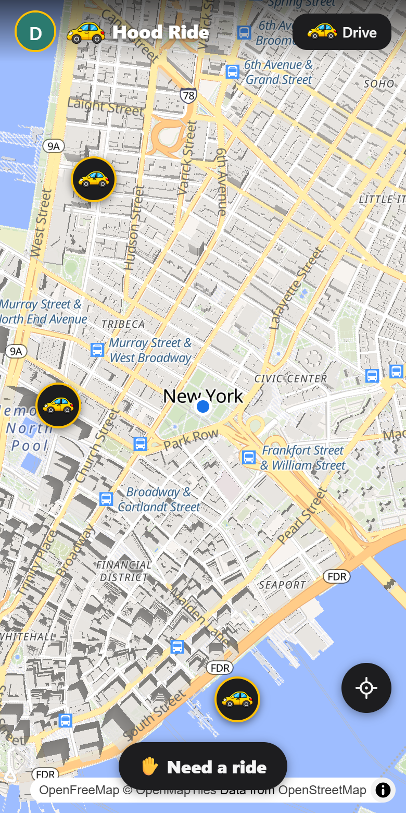

# Hood Ride

**Rides from your neighborhood.** People who need a ride and people driving
by find each other on a map, message, and ride together. A web app that works
on any phone, with nothing to install.

<p align="center"></p>

Try the demo at **[hoodride.app/?demo](https://hoodride.app/?demo)**. It's a
pretend neighborhood, with no account needed.

**Privacy comes first.** Nobody sees exactly where you are until you're in a
ride together. Until then, others only see roughly where you are (an area
about 350 m across). Your exact location is never stored, and rides and
messages are kept in memory only, never in a database. The full story is in the
[privacy policy](https://hoodride.app/privacy).

## Try it on your computer

About 10 minutes. No server or Google account needed.

1. **Install Elixir** (1.17 or newer; it comes with Erlang):
   [elixir-lang.org/install](https://elixir-lang.org/install.html)
   - Windows: the installer on that page
   - macOS: `brew install elixir`
   - Linux: the steps on that page for your distribution
2. **Get the code and start it:**
   ```
   git clone https://github.com/hoodride/hoodride.git
   cd hoodride
   mix setup
   mix phx.server
   ```
3. **Open [localhost:4000](http://localhost:4000)** and tap
   **Continue with Google**. On your own computer that signs you in as a test
   user (`Tester-…`) without going to Google. A private window, or another
   browser, is a second test user, so you can be the rider in one and the
   driver in the other.

   Or open **[localhost:4000/?demo](http://localhost:4000/?demo)** for the
   pretend neighborhood.

**Before sending changes:** `mix precommit` runs every check: the tests, the
security scan (Sobelow), the JavaScript tests (needs
[Node.js](https://nodejs.org) 20+), and a scan for secrets if
[gitleaks](https://github.com/gitleaks/gitleaks) is installed.

## Run your own

Hood Ride runs on one server (Ubuntu 24.04) behind a free Cloudflare
Tunnel, which means no open ports and no certificates to manage.
**[SELF_HOSTING.md](SELF_HOSTING.md)** walks through it step by step, and
**[GOOGLE_SETUP.md](GOOGLE_SETUP.md)** covers the Google sign-in keys (and
the optional Cloudflare Turnstile bot check on sign-in).

Please use your own name, logo, privacy policy and terms; the guide lists
everything to change.

Would a Docker setup help you? [Open an issue](../../issues) and say so.

## Community

Questions, ideas, or running Hood Ride where you live? Come say hi on
**[Discord](https://discord.gg/ehce7eGQFt)**, or start a thread in
[Discussions](../../discussions). Bugs and requests go in
[Issues](../../issues).

## How it works

Built with [Elixir](https://elixir-lang.org) and
[Phoenix](https://www.phoenixframework.org), with live updates over
WebSockets. The map is [MapLibre](https://maplibre.org) with
[OpenFreeMap](https://openfreemap.org) tiles, and the map's areas are
[H3](https://h3geo.org) hexagons. Accounts live in SQLite; everything live
(who's on the map, rides, messages) is kept in memory.
[ARCHITECTURE.md](ARCHITECTURE.md) explains the design and why.

## License

[MIT](LICENSE): use it, change it, share it. Files by others keep their own
licenses ([THIRD-PARTY.md](THIRD-PARTY.md)). The "Hood Ride" name and logo
aren't covered by the license.

Found a security problem? Please report it privately; see
[SECURITY.md](SECURITY.md).
